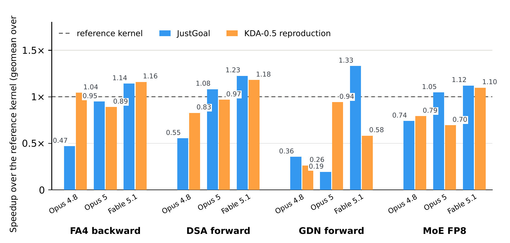

<div align="center">

# JustGoal: Surpassing Expert Kernels and Specialized Kernel Agents with Only a Goal

**GPU kernels written on NVIDIA B200 by a general-purpose agent given only an optimization goal**

**English** | [中文](README_zh.md)

[](paper.pdf)
[](#repository-layout)

[](LICENSE)
[](https://github.com/vincent317/Crossing-The-Expert-Line-Without-Expert-Machinery/stargazers)
[](https://github.com/vincent317/Crossing-The-Expert-Line-Without-Expert-Machinery/issues)



<sub>Speedup of JustGoal and the KDA-0.5 reproduction over the reference kernel across model
generations on four operators; each bar is the geometric mean over the operator's shapes, the
dashed line is the reference kernel.</sub>

</div>

This repository releases the operator (kernel) code from the paper
[*JustGoal: Surpassing Expert Kernels and Specialized Kernel Agents with Only a Goal*](paper.pdf).
JustGoal gives a general-purpose agent only an optimization objective and constraints, without
kernel-specific evaluation infrastructure, knowledge bases, or search workflows. The agent builds
its own evaluation loop and iterates on its implementations. On NVIDIA B200, JustGoal outperforms
the evaluated open-source library implementations on **9 of 11** operators, with per-operator
geometric mean speedups of **1.14–2.34×**, and surpasses the fastest evaluated agent-generated
implementation on **5 of the 10** operators that have one. With **Fable 5.1**, single-shape
JustGoal achieves a geometric mean speedup of **1.24×** across 12 evaluation shapes over our
KDA-0.5 reproduction.

## News

- 📌 **Pinned**: the paper draft is available as [`paper.pdf`](paper.pdf).
- **2026-10-23**: Retest results for the released kernels, including the directories classified as invalid, are in [`benchmarks/flashinfer/`](benchmarks/flashinfer/remainder-03413a0-20261022/README.md).
- **2026-10-22**: Kernel code released under the Apache License 2.0.
- **2026-09-25**: Paper draft added.

## Repository Layout

| Directory | Contents |
|-|-|
| [`goal_single_shape/`](goal_single_shape/) | `/goal` runs on a single specified shape |
| [`goal_full_shape/`](goal_full_shape/) | `/goal` runs on all shapes of an operator definition |
| [`kda05_reproduction_full_shape/`](kda05_reproduction_full_shape/) | Runs under the KDA-0.5 setup |
| [`kda05_reproduction_single_shape/`](kda05_reproduction_single_shape/) | Runs under the KDA-0.5 setup on a single specified shape |
| [`ablation/`](ablation/) | Ablation runs |
| [`benchmarks/`](benchmarks/) | Retest results and evidence |

Kernels are organized as `<operator>/<shape>/<model>/`. The `goal_full_shape/`,
`kda05_reproduction_full_shape/` and `kda05_reproduction_single_shape/` kernels come
with a [flashinfer-bench](https://github.com/flashinfer-ai/flashinfer-bench)
`solution.json`.

## Environment

- GPU: NVIDIA B200 (`sm_100a`)
- CUDA: 13.0 (`nvcc` 13.0.88, driver 580.105.08). Two kernels point at a CUDA 13.1
  toolkit: `goal_single_shape/mla_paged_prefill/b1_q33_kv34/opus-5` and
  `goal_single_shape/gqa_paged_decode/b16_kv2841/opus-5`.
- CuTe DSL (`nvidia-cutlass-dsl`): 4.6.2. The DSA, GDN and MoE kernels in
  `kda05_reproduction_full_shape/` and `kda05_reproduction_single_shape/` use 4.6.0,
  the version pinned by the KDA-0.5 setup.

## Contributing

Issues and pull requests are welcome, in particular bug reports on wrong results or
build failures, and retest results from other B200 setups.

## Citation

<details>
<summary>BibTeX</summary>

```bibtex
@misc{chen2026justgoal,
  title  = {JustGoal: Surpassing Expert Kernels and Specialized Kernel Agents with Only a Goal},
  author = {Chen, Yaojian and Peng, Dazhi and Zhu, Zhui and Li, Leshan and Sun, Haojun
            and Zheng, Yiyun and He, Qingfeng and Li, Shangzhan and Deng, Xianglong
            and Shen, Yifei and Xiang, Shengye and Li, Zhen and Gan, Lin and Li, Yuxuan
            and Han, Xu and Liu, Zhiyuan},
  year   = {2026},
  howpublished = {\url{https://github.com/vincent317/Crossing-The-Expert-Line-Without-Expert-Machinery}}
}
```

</details>

## License

Licensed under the [Apache License, Version 2.0](LICENSE). Files adapted from NVIDIA
CUTLASS examples keep their BSD-3-Clause headers and license; they are listed in
[`NOTICE`](NOTICE).

## Acknowledgments

We build on [FlashInfer](https://github.com/flashinfer-ai/flashinfer),
[flashinfer-bench](https://github.com/flashinfer-ai/flashinfer-bench) and the
MLSys 2026 contest workloads,
[FlashAttention](https://github.com/Dao-AILab/flash-attention), and
[CUTLASS / CuTe DSL](https://github.com/NVIDIA/cutlass).

This work is from [Tsinghua University](https://www.tsinghua.edu.cn/en/),
[ModelBest](https://modelbest.cn/),
[Harbin Institute of Technology](https://en.hit.edu.cn/) and the
[University of Chinese Academy of Sciences](https://english.ucas.ac.cn/).
