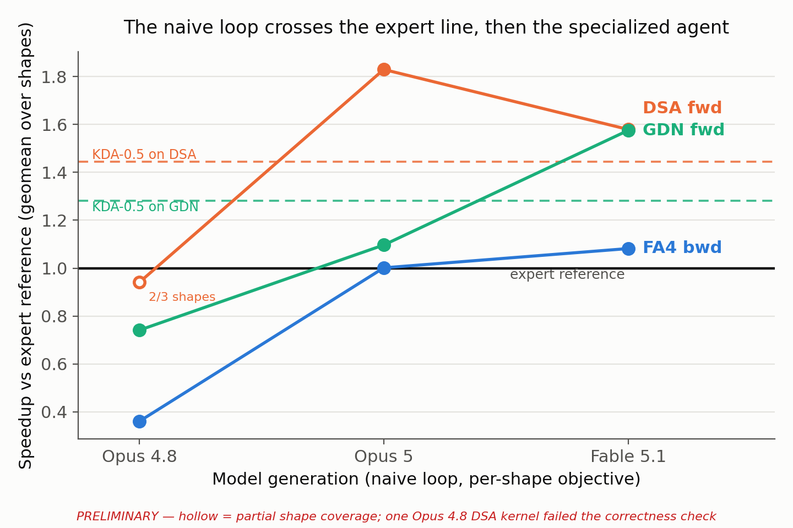

<div align="center">

# Crossing the Expert Line Without Expert Machinery

**GPU kernels written by a frontier coding agent in a naive loop, beating expert-written kernels on NVIDIA B200**

**English** | [中文](README_zh.md)

[](paper.pdf)
[](#repository-layout)

[](LICENSE)
[](https://github.com/vincent317/Crossing-The-Expert-Line-Without-Expert-Machinery/stargazers)
[](https://github.com/vincent317/Crossing-The-Expert-Line-Without-Expert-Machinery/issues)



</div>

This repository releases the operator (kernel) code from the paper
[*Crossing the Expert Line Without Expert Machinery*](paper.pdf). A general-purpose
coding agent receives one workload shape and a short goal, and iterates in a **naive
loop**: no kernel-specific evaluation infrastructure, domain knowledge, or workflow.
The agent writes its own correctness oracle and timing loop. With **Fable 5.1**, the
kernels it produces reach **1.08×–1.58×** the fastest expert-written references on
FlashAttention-4 backward, DeepSeek Sparse Attention and Gated DeltaNet.

## Highlights

- 🧪 **Naive loop**: only the generic agent loop every coding agent already runs; no harness engineering
- 🚀 **Past the expert line**: Fable 5.1 is at or above the expert references on all three operators studied (**1.08×** FA4 bwd, **1.58×** DSA, **1.58×** GDN)
- ⚡ **FlashAttention-4 backward**: Fable 5.1 beats FA4's own official backward kernels on two of three shapes
- 🤖 **Past the specialized agents**: on DSA and GDN, KDA-0.5 reaches 1.45× and 1.28×, AKO4X's archived kernels 1.02× and 0.57×; Fable 5.1 reaches 1.58× on both
- 📈 **Across model generations**: Opus 4.8, Opus 5 and Fable 5.1 under one prompt, harness and stopping rule, so the model is the only variable
- ✅ **Verified by us, not the agent**: every reported kernel is checked against a naive fp32 oracle on held-out inputs, at the error scale of the reference it claims to beat
- 📦 **Open kernels**: CUDA, CuTe DSL and Triton kernels for 11 operator families, under Apache 2.0

How the naive loop differs from specialized kernel agents
(the three kernel-specific harness components, from Table 1 of the paper):

| System | Evaluation infra | Domain knowledge | Prescribed workflow |
|-|-|-|-|
| **Naive loop (ours)** | ❌ | ❌ | ❌ |
| KDA | ✅ NCU profiler skill | ✅ | ✅ |
| AKO | ✅ | ✅ | ✅ |
| AVO | ✅ | ✅ | ✅ |
| CAKE | ✅ | ✅ | ✅ |

## News

- 📌 **Pinned**: the paper draft is available as [`paper.pdf`](paper.pdf).
- **2026-10-23**: Retest results for the released kernels, including the directories classified as invalid, are in [`benchmarks/flashinfer/`](benchmarks/flashinfer/remainder-03413a0-20261022/README.md).
- **2026-10-22**: Kernel code released under the Apache License 2.0.
- **2026-09-25**: Paper draft added.

## Contents

- [Repository Layout](#repository-layout)
- [Environment](#environment)
- [Limitations](#limitations)
- [Contributing](#contributing)
- [Citation](#citation)
- [License](#license)
- [Acknowledgments](#acknowledgments)

## Repository Layout

| Directory | Contents |
|-|-|
| [`goal_single_shape/`](goal_single_shape/) | `/goal` runs on a single specified shape |
| [`goal_full_shape/`](goal_full_shape/) | `/goal` runs on all shapes of an operator definition |
| [`kda05_reproduction/`](kda05_reproduction/) | Runs under the KDA-0.5 setup |
| [`ablation/`](ablation/) | Ablation runs |
| [`benchmarks/`](benchmarks/) | Retest results and evidence |

Kernels are organized as `<operator>/<shape>/<model>/`. The `goal_full_shape/` and
`kda05_reproduction/` kernels come with a
[flashinfer-bench](https://github.com/flashinfer-ai/flashinfer-bench) `solution.json`.

## Environment

- GPU: NVIDIA B200 (`sm_100a`)
- CUDA: 13.0 (`nvcc` 13.0.88, driver 580.105.08). Two kernels point at a CUDA 13.1
  toolkit: `goal_single_shape/mla_paged_prefill/b1_q33_kv34/opus-5` and
  `goal_single_shape/gqa_paged_decode/b16_kv2841/opus-5`.
- CuTe DSL (`nvidia-cutlass-dsl`): 4.6.2. The DSA, GDN and MoE kernels in
  `kda05_reproduction/` use 4.6.0, the version pinned by the KDA-0.5 setup.

## Limitations

- The kernels target the B200 only and were measured on it only.
- Most kernels are specialized for the shapes they were optimized on and are not
  general-purpose library kernels.
- The paper is a preliminary draft. The retest in [`benchmarks/`](benchmarks/) marks
  some released directories invalid; see its
  [`coverage.json`](benchmarks/flashinfer/remainder-03413a0-20261022/coverage.json)
  before relying on a specific kernel.

## Contributing

Issues and pull requests are welcome, in particular bug reports on wrong results or
build failures, and retest results from other B200 setups.

## Citation

<details>
<summary>BibTeX</summary>

```bibtex
@misc{chen2026crossing,
  title  = {Crossing the Expert Line Without Expert Machinery},
  author = {Chen, Yaojian and Peng, Dazhi and Li, Leshan and Sun, Haojun
            and Zheng, Yiyun and He, Qingfeng and Zhu, Zhui and Xiang, Shengye
            and Li, Zhen and Gan, Lin and Li, Yuxuan and Han, Xu and Liu, Zhiyuan},
  year   = {2026},
  howpublished = {\url{https://github.com/vincent317/Crossing-The-Expert-Line-Without-Expert-Machinery}}
}
```

</details>

## License

Licensed under the [Apache License, Version 2.0](LICENSE). Files adapted from NVIDIA
CUTLASS examples keep their BSD-3-Clause headers and license; they are listed in
[`NOTICE`](NOTICE).

## Acknowledgments

We build on [FlashInfer](https://github.com/flashinfer-ai/flashinfer),
[flashinfer-bench](https://github.com/flashinfer-ai/flashinfer-bench) and the
MLSys 2026 contest workloads,
[FlashAttention](https://github.com/Dao-AILab/flash-attention), and
[CUTLASS / CuTe DSL](https://github.com/NVIDIA/cutlass).

This work is from [Tsinghua University](https://www.tsinghua.edu.cn/en/) and
[ModelBest](https://modelbest.cn/).
